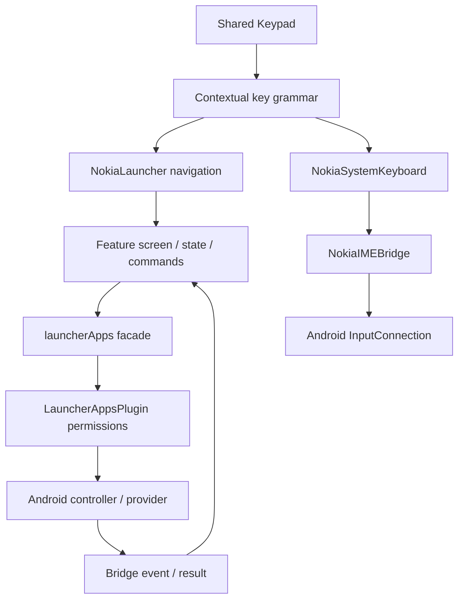

# Nokia Launcher architecture

Developer entry point, verified against the working tree on 2026-09-11. The active product is this frontend plus its Android host. The sibling `backend/` is a separate optional API, not the installed launcher runtime. Historical copies and generated `build/`/Android assets are not source owners.

Start with `npm run trace -- keyboard`, `npm run trace -- camera`, or `npm run trace -- sms`. `npm run check:architecture` checks map paths and the limited dependency rules implemented by the checker. It is not a general correctness or security proof.

## Implemented structure

```text
src/
  App.js                     entry: eager IME, lazy launcher
  LauncherApp.jsx            launcher routes and shell
  components/
    NokiaLauncher.jsx        navigation and feature orchestration (still large)
    Screen.jsx               miniscreen rendering (still includes messages)
    Keypad.jsx               one physical input surface shared by both hosts
    NokiaSystemKeyboard.jsx  IME UI and existing IME adapter
  domain/
    keyGrammar.js            contextual intent and shared key vocabulary
    multiTapComposer.js      multi-tap timing and composition
    launcherMenus.js         menu/default-app rules; storage defaults are legacy
  features/
    browser/                 screen, URL rules, commands, keypad controller
    camera/                  screen, state reducer, commands
    clock/                   clock/timer/stopwatch and persistence
    snake/                   engine, board, input and persistence
    sound/                   settings, audio engine and host-specific feedback
  lib/
    launcherApps.js          public launcher-to-native facade; still large
    playIntegrity.js         separate integrity adapter
    smsReadStatus.js         local read markers; not Android SMS delivery truth
android/app/src/main/java/com/nokialauncher/
  LauncherEntryActivity.java app-icon -> Home routing
  MainActivity.java          single Home host, window and renderer lifecycle
  LauncherAppsPlugin.java    bridge/permissions; still includes SMS/contact queries
  NokiaIME.java              InputMethodService, trusted WebView, InputConnection
  InputSessionPolicy.java    keyboard visibility policy
  KeyboardResourcePolicy.java  packaged-resource trust rule
  NokiaNotificationListener.java notification ingestion, cache, reply handles
  SmsBroadcastReceiver.java  SMS events
  BoundedInputReader.java    bounded provider stream consumption
  browser/BuiltInBrowserController.java  isolated remote browsing and tabs
  camera/BuiltInCameraController.java    CameraX, media, native surfaces
  camera/BitmapDecodePolicy.java         bounded photo decode dimensions
docs/architecture/
  modules.json              searchable ownership/test map
  FEATURE_TEMPLATE.md       contract for extending a feature
  MAINTENANCE.md            trace workflow, evidence and incremental roadmap
```

## Trace the full behavior



For each bug, identify the first point where actual behavior differs from the contract. A facade mock proves routing, not native resource release, Android delivery, audible output, or device latency.

## Ownership and compatibility decisions

| Decision | Reason and constraint |
| --- | --- |
| Keep the shared keypad and existing facade | Both launcher and IME already depend on their behavior. Extend these seams instead of duplicating input dispatch. |
| Feature-local rules and tests | Keep maintenance local. Add a helper only when it hides actual complexity or is reused. |
| Eager IME entry | Keyboard first paint must not wait for a lazy chunk. Keep local assets readable while preventing remote content from reaching its bridge. |
| Separate browser trust domain | Browser pages use their own WebViews without the IME bridge; SSL failures are cancelled. |
| One native resource owner | A controller owns its renderer/camera/executor. Teardown and late callbacks are part of its interface. |
| Local caches are bounded and non-authoritative | A read marker is not message delivery; cached app lists may be stale; notification history is not a mailbox. |
| Small measured changes | Preserve the Nokia-era calm and approved visuals. Measure p50 and tail latency on the exact APK; do not infer speed from code size. |

Established project constraints: [product mission](../../docs/PRODUCT_NORTH_STAR.md), [performance guardrails](../../docs/PERFORMANCE_GUARDRAILS.md), [original seam audit](../../docs/reports/2026-08-20%20%E2%80%94%20Nokia%20Launcher%20UI%20Architecture%20Audit.md).

## Target extension shape — a template, not completed migration

```text
src/features/<feature>/
  <Feature>Feature.jsx     rendering, subscription and command orchestration
  <feature>State.js        pure transitions where state complexity warrants them
  <feature>Commands.js     contextual actions using the shared key grammar
  <feature>Storage.js      validation, versioning, quota/failure handling if needed
  *.test.js[x]            observable rules and feature behavior
```

Create only the files the feature needs. Native operations continue through the current facade. For a substantial native feature, use an existing or new package under `com/nokialauncher/<feature>/`; expose a small controller interface, keep resource internals private, and add policy tests under the matching test package.

Messages are the first planned extraction: move validated thread identity/state and then rendering out of the large launcher/Screen, preserving behavior at each step. Native SMS/contact queries can later move behind a focused repository/controller while keeping bridge method names stable. These extractions have **not** been performed in this audit.
